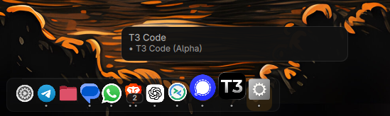
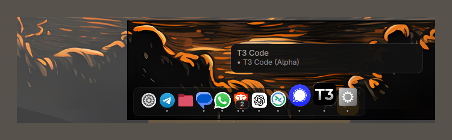

# Omadocked

A native dock for [Omarchy](https://omarchy.org): running apps, pins, folders, and custom launchers on every selected display.

Plugin id: `burmjohn.omadocked`.





## What it does

Omadocked is a bottom shelf overlay for Hyprland and Omarchy. It shows pinned and running apps, optional folders, and custom launchers, plus a hover window fan (still previews require host support; see Compatibility below). The Omarchy menu sits left of Settings. Settings cover icon size, transparency, magnification, auto-hide, outputs, and window-count badges (four corners plus theme or `#RRGGBB` background/text colors). Open **Badges** in Settings to edit them; press Enter to save a color. The panel opens in place; click outside it to close.

Click-to-minimize can be off, the active window, or all windows of an app.

Settings and pins are stored in `~/.config/omadocked/pins.json`.

Omadocked is a shell plugin only. Do not point `OMARCHY_PATH` or Hyprland at a copy of Omarchy under `~/.local/share/omadocked/omarchy`. Idle, lock, and `omarchy-shell` belong to packaged Omarchy (`/usr/share/omarchy`).

## Features

- Bottom shelf on the displays you choose
- Omarchy menu left of Settings (toggles the default Omarchy menu)
- Settings for size, transparency, auto-hide, and outputs; click outside to close
- Wave or zoom magnification, or motion off
- Pins, running apps, folders, and optional names
- Hover window fan; still previews only when the host exposes the required privacy service
- Custom launchers: apps, commands, links, and folders
- Click-to-minimize: active window, all windows, or off

## Install

```sh
omarchy plugin add https://github.com/burmjohn/omadocked --enable
```

The installer validates, rescans and enables the plugin. A shared-shell restart
is not a routine installation step. See [maintenance](docs/maintenance.md) for
tested versions, update semantics and rollback precautions.

## Disable or remove

**Recover parked windows before disabling.** Click-to-minimize can leave windows
on private workspaces even when the dock is hidden. Follow the exact IPC
[recovery procedure](docs/recovery.md): recover to origin, then read status back
until `ready: true`, `busy: false`, `last.ok: true`, and `records: []`.
Do not disable while records remain or recovery reports an error.

Only after that verified empty read-back:

```sh
omarchy plugin disable burmjohn.omadocked
```

Already disabled with parked windows? Re-enable with
`omarchy plugin enable burmjohn.omadocked`, then follow the recovery procedure
before disabling again. Keep both `pins.json` and the parking journal;
deleting the journal does not restore windows. Disabling leaves your settings in place.

To uninstall the plugin files after recovery and disabling, run:

```sh
omarchy plugin remove burmjohn.omadocked
```

This can delete the installed Git checkout, including local edits. Back it up
first if needed. Configuration and parking state live outside that checkout;
keep them for recovery or a later reinstall.

## Feedback

This is an early public preview. Bug reports, ideas, and pull requests are welcome.

- [Open an issue](https://github.com/burmjohn/omadocked/issues)
- [Open a pull request](https://github.com/burmjohn/omadocked/pulls)

Please include Omarchy and Quickshell versions and steps to reproduce. Do not attach private window titles, notification text, or an unredacted `pins.json`.

## Requirements

- [Omarchy](https://omarchy.org) with Quickshell
- Hyprland
- `python3` and `python-gobject` for desktop-entry launches
- `xdg-open` for opening folder-stack entries
- `xdg-terminal-exec` for command-in-terminal items and folder-stack terminals

Candidate version is `0.1.7` in [`manifest.json`](manifest.json), not a published
release. See [CHANGELOG.md](CHANGELOG.md) and the
[tested dependency baseline](docs/maintenance.md#verified-dependency-baseline).

## Compatibility

The installed stock Omarchy public plugin facade does not expose the privacy
projection or cross-plugin service lookup required by this dock's integrations.
Still-preview capture therefore stays unavailable (fail-closed); enabling a
preview setting does not grant that capability. The hover fan remains usable
without captured window images. Notification-driven attention and sound also
require an exposed notification service and are unavailable through that stock
facade. Window urgency is a separate source of attention.

This is a host API limitation, not a missing screenshot utility. Do not bypass
privacy checks, create a second notification server, or install a replacement
host overlay to work around it. Packaged Omarchy continues to own lock and idle.

## Import from Omadock

Preview first; this reads sources without acquiring the destination lock or
writing any destination files. Run from this repository (or the installed
plugin directory):

```sh
python3 tools/import_omadock.py
```

Review the mapped values and `unsupported` list. Explicit integer icon sizes
from 28 through 72 are imported; `0`/`auto` remain unsupported. Applying replaces
the destination configuration rather than merging it:

```sh
python3 tools/import_omadock.py --apply --dest "$HOME/.config/omadocked/pins.json"
```

The destination must already exist. Apply takes the same exclusive lease as the
dock's configuration helper. While the dock owns it, apply returns `busy` with a
nonzero exit and leaves main and backup bytes unchanged. Recover parked windows
before disabling the dock to release that lease; re-enable it after importing.
Never delete the lock file to force an import. Apply preserves the exact previous
bytes in `pins.json.import-bak`, then uses the shared Store conflict check,
atomic write, fsync and read-back path. Its JSON receipt retains durability and
backup-degradation fields; `indeterminate` is not success and must be reconciled
before retrying. Apply refuses absent source files and an existing import backup;
archive that original backup deliberately before importing again. A valid dock-only
or settings-only source is supported. Preview does not validate destination writability.

## Development

```sh
make test             # spawn-safety guards
make test-offscreen   # Python + Qt/Quickshell; installed Omarchy required
make lint
make bench            # bounded model microbenchmarks
```

See [maintenance](docs/maintenance.md#development-gates) for dependencies and
coverage limits. `make preview` starts a real, actionable standalone dock using
ordinary saved state by default; it is not an isolated test or an inert demo.

## License

[MIT](LICENSE).
